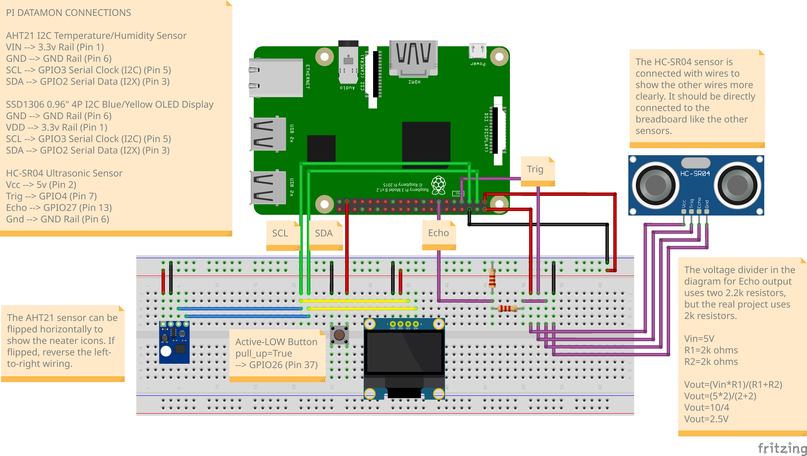

# Pi Datamon

A data acquisition and monitoring system for temperature, humidity, and distance.

## Hardware Setup

### Components

- Raspberry Pi 3B+
- Breadboard
- Tactile Push Button
- Jumper Wires
- 2kΩ Resistor (x2)
- SSD1306 Blue/Yellow OLED Display ([Datasheet](https://cdn-shop.adafruit.com/datasheets/SSD1306.pdf))
- AHT21 Temperature and Humidity Sensor ([Datasheet](https://asairsensors.com/wp-content/uploads/2021/09/Data-Sheet-AHT20-Humidity-and-Temperature-Sensor-ASAIR-V1.0.03.pdf))
- HC-SR04 Ultrasonic Distance Sensor ([Datasheet](https://cdn.sparkfun.com/datasheets/Sensors/Proximity/HCSR04.pdf))

### Breadboard Layout



## Running Project

Project dependencies are defined in both the `devenv.nix` development environment file and the `pyproject.toml` project configuration file used by `uv`.

### Enabling I2C on Raspberry Pi

The Raspberry Pi needs to be configured to enable I2C for the AHT21 sensor and the SSD1306 display.

1. On Raspberry Pi OS, configure I2C, then reboot.

```
sudo raspi-config
```

2. Optionally increase the performance of I2C by adding the following to `/boot/firmware/config.txt`. Reboot afterwards.

```
dtparam=i2c_arm=on,i2c_baudrate=400000
```

3. Add your user to the `i2c` group, then log out and back in. This is for accessing `i2c-tools`.

```
sudo usermod -a -G i2c $USER
```

4. Verify I2C devices using:

```
i2cdetect -y 1
```

### Recording/Simulating Sensor Data

On the Raspberry Pi, the following command starts the main application that records sensor data and displays it on the OLED. Press the tactile button to cycle between the three modes for each sensor: temperature, humidity, and distance. Logs are written to `log/sensor_log.csv`.

```
just run
```

For testing, a simulator program is included, which can be run with:

```
just simulate
```

### Visualizing Sensor Data

Visualization is performed outside of the Raspberry Pi. The `log/sensor_log.csv` file can be extracted from the Raspberry Pi for non-live analysis, but for live visualization, this implementation relies on mounting the Raspberry Pi's log directory remotely. [sshfs](https://github.com/libfuse/sshfs) is used (MacOS additionally requires [macfuse](https://github.com/macfuse/macfuse) and enabling system extensions).

Run the following command to mount the log directory with `sshfs`:

```
just mount
```

Then, while sensor data is being recorded or simulated, run the visualizer, which opens a new window.

```
just visualize
```

To statically visualize the existing `log/sensor_log.csv` file, run:

```
just graph
```
